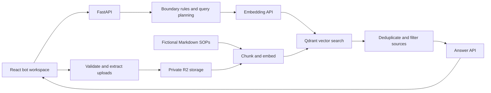

# Architecture

Sentral Ops includes retrieval-augmented question answering and an autonomous document
task harness. The `/api/ask` retrieval planner is deterministic Python code. The
separate `/api/tasks` harness lets a model choose registered tools to complete a job.

## Follow a question

`POST /api/ask` accepts a question, a retrieval limit, and up to six conversation turns.
[`main.py`](../backend/app/main.py) resolves the authenticated account workspace and calls
[`RagAssistant.ask`](../backend/app/rag.py).

1. **Boundary check.** [`guardrails.py`](../backend/app/guardrails.py) uses regular
   expressions to detect requests involving live delivery status, payments, stock,
   approval authority, confidential data, external AI, or substitutions. These are
   warnings, not a security classifier or authorization system.
2. **Query planning.** Start with the original question and add domain-specific queries
   based on wording and warnings, up to three in total. A short follow-up includes
   the previous user question in the first query.
3. **Retrieval.** Embed the queries in one API batch, search Qdrant for each, merge
   duplicate chunk IDs, and keep the highest score for each chunk. Queries include
   shared SOPs and uploads belonging to the current authenticated workspace.
4. **Grounding check.** Discard results below `MIN_SOURCE_SCORE` and cap the remaining
   context with `MAX_CONTEXT_SOURCES`. If none pass, return an `outside_scope` warning
   without calling the answer model. Query embeddings have still used the provider API.
5. **Answer synthesis.** Label the excerpts `S1`, `S2`, and so on. Send the question,
   recent conversation, warnings, and excerpts to the answer model. The prompt asks
   for factual claims to cite these labels and treats source text as data.

The response contains `answer`, `sources`, `warnings`, and `agent_steps`. The UI's
Agent Trace shows execution summaries, planned queries, and counts. It does not expose
hidden model reasoning. Source scores measure vector similarity, not the probability
that an answer is correct. Citations are requested in the prompt and are not verified
automatically.

## Index the shared corpus

[`documents.py`](../backend/app/documents.py) loads the Markdown corpus and its headings
and metadata. [`chunking.py`](../backend/app/chunking.py) splits it into overlapping
chunks with stable IDs. [`ingestion.py`](../backend/app/ingestion.py) embeds batches
and upserts them through [`qdrant_store.py`](../backend/app/qdrant_store.py).

Stable vector IDs make repeated ingestion idempotent for unchanged chunks. Ingestion
does not remove stale chunks after a document is shortened or deleted. For a clean
rebuild, use a new `QDRANT_COLLECTION` and reindex. Changing the embedding model or
dimensions also requires a new collection; answer-model changes do not.

## Upload lifecycle

[`uploads.py`](../backend/app/uploads.py) accepts UTF-8 Markdown and text-based PDFs.
Limits are 10 MiB per file, 100 PDF pages, and 200,000 extracted characters. PDF parsing
runs in [`pdf_extract.py`](../backend/app/pdf_extract.py) as a separate process with
CPU and wall-clock limits. Linux, including Docker, also applies a 256 MiB address-space
cap; that memory limit is unavailable during native macOS development. Scanned PDFs
have no OCR support; encrypted PDFs are rejected.

The backend saves the original file, extracted text, and JSON metadata in private R2
storage before attempting indexing. If embeddings fail, the document remains `saved`
with a safe error message. An indexing retry reuses the saved text. Successful indexing
changes the status to `indexed`. Deletion removes vectors first, then stored objects.

Content hashes identify duplicate uploads within a workspace. Workspace-prefixed
vector IDs keep identical uploads in different workspaces separate.

## Workspace and chat state

The frontend wraps the application in Clerk's React provider and mounts the workspace
only for an active session. Each API request, including file downloads, obtains a
session token and sends it in the Authorization header. The account menu handles
account switching and sign-out. Session changes remount application state.

[`auth.py`](../backend/app/auth.py) verifies RS256 signatures against a configured
public key or cached JWKS from the configured Clerk issuer. It requires the exact
issuer, valid time claims, a user and session ID, and an authorized frontend origin.
It rejects pending/inactive sessions and fails closed when configuration is missing.
Health checks and fictional demo questions remain public; private document, question,
task, bot, memory, and HTTP ingestion routes require authentication. OpenAPI exposes
a bearer-token Authorize control. The ingestion command remains available locally.

[`workspaces.py`](../backend/app/workspaces.py) derives a 64-character workspace key
from the verified issuer and user ID. R2 paths, Qdrant filters, tasks, bots, and memories
use that account-owned key. Different sessions/devices for the same account share it;
different Clerk instances do not. No browser-provided user ID or workspace cookie
can override ownership. This is individual account isolation, not organization/team RBAC.
Anonymous records from earlier versions remain stored but are not automatically claimed
by an account. Re-upload demo files or plan a deliberate administrator migration.

The workspace renders server-backed bot profiles, task summaries, task details,
routines, and memory. It polls task state while the page is visible and retrieves
changed task details; active jobs continue in the worker when the browser closes.
Only the selected bot ID is saved in account-scoped local storage. Historical local
chat caches from the earlier question-answering UI are left intact and are not
imported into task conversations. Deleting knowledge or forgetting memory does not
erase saved task excerpts, artifacts, or task history.

## Why this design

A basic RAG pipeline embeds one question, retrieves chunks, and generates an answer.
This project adds explicit planning and grounding decisions while keeping them readable
and testable. The planner avoids an additional model call and makes retrieval behavior
easy to trace. Its rules are specific to the fictional corpus, so new domains need new
rules and evaluation questions.

The question-answering implementation does not include reranking, document approval,
OCR, live operational data, or enforced citation verification. Those are useful areas
for contributions with clear tests and documented tradeoffs.

## Autopilot harness

The harness is the runtime around the model: it supplies context and tool definitions,
executes validated actions, checkpoints results, enforces limits, and decides when a
job can stop. Its entrypoint is `POST /api/tasks`, with a goal, completion criteria,
and optional context. Submission returns `202`; execution belongs to the separate
`python -m app.harness.worker` process, so closing the browser does not interrupt work.

The modules in `backend/app/harness/` have distinct responsibilities:

| Module | Responsibility |
| --- | --- |
| `model.py` | Model protocol and a Responses API adapter using the existing provider settings |
| `tools.py` | Explicit tool registry, strict argument validation, workspace-bound tools, artifact checks |
| `runner.py` | Model/tool loop, usage accounting, pending calls, receipts, retries, stopping conditions |
| `store.py` | SQLite task state, checkpoints, owner controls, and workspace isolation |
| `memory.py` | Bot profiles, owner preferences, bounded recall, and transactional outcome memory |
| `routines.py` | Timezone-aware schedules and atomic, account-scoped task dispatch |
| `worker.py` | Single-worker process lock, routine dispatch, restart recovery, polling and graceful shutdown |
| `api.py` | Create, list, inspect, cancel, and resume jobs |

### Execution and recovery

1. The worker claims a queued task and reserves a model turn in SQLite before sending
   a request. Interrupted requests still consume the turn allowance.
2. The model selects one tool. Output items, including encrypted reasoning context,
   are checkpointed before execution. Reasoning contents are not exposed by the task API.
3. Tool arguments are validated against Pydantic schemas. Workspace and task IDs are
   bound by server code, never accepted from model arguments.
4. Tool results, receipts, local artifact changes, and the updated transcript are
   committed together. A crash before this commit replays the saved call; a crash
   after it resumes from the committed result. Current tools perform read-only remote
   operations or local checkpointed writes, which makes that replay safe.
5. The agent continues autonomously until completion, a blocker, cancellation, failure,
   or an execution limit. A text response alone cannot complete the task.

The adapter follows the official
[Responses function-calling flow](https://developers.openai.com/api/docs/guides/function-calling),
keeps returned reasoning items for subsequent calls, and uses `store=False`. The
configured provider must support Responses as well as the existing embedding API;
generic Chat Completions compatibility alone is insufficient. The existing `/api/ask`
integration is unchanged.

Transient network errors, HTTP 429, and server failures receive up to three retries
with backoff. Persistent failures become `failed`, with a safe error and saved progress.
Owners may supply context and resume `needs_input` or `failed` tasks. Resuming keeps
the original turn, token, and active-runtime accounting. Cancellation wins over an
in-flight response; the worker checks it before checkpointing or starting another action.
An already dispatched remote request can still finish and consume provider credits.

Limits are checked between operations. Token accounting covers reported model usage;
it excludes embeddings and usage lost when a process dies before receiving or saving
a response. A request's input tokens can cross the remaining allowance before its
usage is reported. Runtime accounting covers active execution between checkpoints,
excluding queue waits and human response time; a crash can lose the uncheckpointed
interval. These are execution controls, not hard provider spending guarantees.

### Tools and completion

The initial registered tools are `search_sops`, `write_artifact`, `read_artifact`,
`complete_task`, and `request_input`. Searches use Qdrant's existing workspace filter
and relevance threshold. Retrieved sources retain stable citation labels within a
task, and task detail exposes those excerpts alongside the deliverable.

Artifacts are Markdown stored inside the task checkpoint, not arbitrary filesystem
paths. Reusing an artifact title replaces its content and invalidates its read-back
check. Completion requires an existing artifact, a read-back of its latest content
hash, and at least one citation, with every `[S<number>]` label matching a retrieved
source. The model is instructed to check the user criteria, but deterministic checks
do not establish semantic correctness, factual grounding, or coverage of every criterion.
Add task-specific evaluators before treating completion as proof of those outcomes.

### Memory across jobs

Task transcripts remain in `tasks`. The additive `bots` and `bot_memories` tables use
the same SQLite database and persistent volume. Existing tasks without a `bot_id`
continue to run independently. New tasks may reference a bot owned by the current
workspace; references to another workspace's bot are rejected.

Profiles hold a name, role, and standing instructions. Owner-entered preferences have
a stable key, value, source, creation/update timestamps, and optional UTC expiry.
Putting the same preference key updates its existing record. A bot has at most 20
preferences, and each value is capped at 1,000 characters. Expired records can be
listed for management but are excluded from retrieval.

Before every model turn, the harness loads the current profile, active preferences,
and at most five past outcomes matching keywords from the goal. It checks the combined
context against the transcript-size limit. Automatic context is supplied as a separate
background-data message; the task checkpoint records its hash and memory IDs, rather
than copying the complete retrieved payload into the task transcript. Owner edits and
deletions therefore affect subsequent retrieval, including the next model turn of an
active task. They do not retract an already dispatched action or erase historical
model outputs and explicit `recall_memory` results.

The read-only `recall_memory` tool can look up additional records. Its workspace and
bot are bound by the server; model-supplied arguments cannot select another scope.
This initial lookup uses bounded SQL keyword matching, not vector similarity. Qdrant
continues to handle document knowledge separately.

Only owner APIs write preferences. The agent has no memory-write tool. For a task
attached to a bot, the completed checkpoint also inserts one outcome record, keyed by
task ID, in the same SQLite transaction. The insert verifies the persisted artifact
content hash, latest read-back, and known citation labels again. Cancellation, failed
verification, and duplicate completion attempts cannot publish a new success record.
Outcome evidence identifies the source task, artifact ID, hash, citation labels, and
the exact checks performed. It explicitly records that semantic accuracy was not
verified; model-generated summaries are not promoted into verified facts.

Memory cannot grant tool permissions or supersede approved policies. Historical
outcomes are context for another job, not a live status check or a guarantee that a
future connector should skip an action. Connector-specific deduplication and external
verification still belong in those integrations.

The `/api/bots` endpoints create/read/update profiles, upsert preferences, list records,
and delete individual memories. Memory deletion prevents future database retrieval;
it does not delete originating tasks, existing artifacts, backups, or prior transcripts.
Automated retention and deletion of entire task histories remain unimplemented.

`python -m app.harness.memory_demo` runs two scripted jobs against fictional data and
a new standalone SQLite file, proving persistence, retrieval, corrections, and forgetting
without provider calls. It leaves that file available for inspection and refuses to
reuse an existing database path.

### Operating boundaries

One worker processes tasks sequentially against a local SQLite database. An OS file
lock prevents a second worker from recovering live jobs. Run the API and worker on
one host with the same writable database directory; network filesystems and distributed
workers are unsupported. Use SQLite's backup facility for backups, or stop both the
API and worker before consistently copying the database and its WAL files.

Bot profiles, memory, task history, tool context, and artifacts live in the `harness_state` Compose volume
or `var/harness.sqlite3` during native development. They are scoped by the existing
verified Clerk account workspace. Retention and task deletion are not yet
implemented. The task list returns the latest 50 summaries; individual task IDs remain
accessible within their workspace.

The runtime has no browser, shell execution, external messaging,
or approval authority. New connectors must implement
idempotent execution and reconciliation using the task/call idempotency key; local
receipts alone do not guarantee exactly-once effects in an external system. Keep these
capabilities explicit in the tool registry and add task-specific success checks.

### Scheduled routines

`/api/routines` stores explicit user-created schedules in the same SQLite database.
Each routine binds a bot, goal, completion criteria, IANA timezone, local time, and a
daily/weekday/weekly recurrence. First-run bot onboarding creates profiles only; it
never creates schedules or starts provider calls. A workspace can have 20 routines.

The single worker checks due routines every 30 seconds between jobs. It creates a
task and advances the schedule in one `BEGIN IMMEDIATE` transaction. Failed dispatch
rolls both changes back. It coalesces missed dates into one run rather than replaying
a backlog. A queued, running, or input-blocked task prevents overlapping runs of the
same routine; manual **Run now** returns that active run too. Pausing prevents future
dispatch but does not cancel a task that has already started. Deleting a routine keeps
its task history. Resuming a paused routine schedules its next future date.

Schedules use local calendar dates. A missing spring daylight-saving time moves
forward by the offset change; an ambiguous autumn time uses its first occurrence,
once per date. Long tasks can delay routine dispatch because the current worker
processes one job at a time. Scheduling is eventual, not a real-time guarantee.
