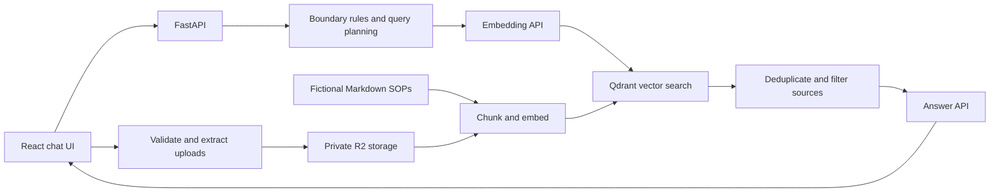

# Architecture

Sentral Ops is a small reference implementation of retrieval-augmented generation
(RAG). The retrieval planner is deterministic Python code. It does not use a model to
choose tools, browse the web, or act on business systems.

## Follow a question

`POST /api/ask` accepts a question, a retrieval limit, and up to six conversation turns.
[`main.py`](../backend/app/main.py) resolves the browser workspace and calls
[`RagAssistant.ask`](../backend/app/rag.py).

1. **Boundary check.** [`guardrails.py`](../backend/app/guardrails.py) uses regular
   expressions to detect requests involving live delivery status, payments, stock,
   approval authority, confidential data, external AI, or substitutions. These are
   warnings, not a security classifier or authorization system.
2. **Query planning.** Start with the original question and add domain-specific queries
   based on wording and warnings, up to three in total. A short follow-up includes
   the previous user question in the first query.
3. **Retrieval.** Embed the queries in one API batch, search Qdrant for each, merge
   duplicate chunk IDs, and keep the highest score for each chunk. Queries include
   shared SOPs and uploads belonging to the current browser workspace.
4. **Grounding check.** Discard results below `MIN_SOURCE_SCORE` and cap the remaining
   context with `MAX_CONTEXT_SOURCES`. If none pass, return an `outside_scope` warning
   without calling the answer model. Query embeddings have still used the provider API.
5. **Answer synthesis.** Label the excerpts `S1`, `S2`, and so on. Send the question,
   recent conversation, warnings, and excerpts to the answer model. The prompt asks
   for factual claims to cite these labels and treats source text as data.

The response contains `answer`, `sources`, `warnings`, and `agent_steps`. The UI's
Agent Trace shows execution summaries, planned queries, and counts. It does not expose
hidden model reasoning. Source scores measure vector similarity, not the probability
that an answer is correct. Citations are requested in the prompt and are not verified
automatically.

## Index the shared corpus

[`documents.py`](../backend/app/documents.py) loads the Markdown corpus and its headings
and metadata. [`chunking.py`](../backend/app/chunking.py) splits it into overlapping
chunks with stable IDs. [`ingestion.py`](../backend/app/ingestion.py) embeds batches
and upserts them through [`qdrant_store.py`](../backend/app/qdrant_store.py).

Stable vector IDs make repeated ingestion idempotent for unchanged chunks. Ingestion
does not remove stale chunks after a document is shortened or deleted. For a clean
rebuild, use a new `QDRANT_COLLECTION` and reindex. Changing the embedding model or
dimensions also requires a new collection; answer-model changes do not.

## Upload lifecycle

[`uploads.py`](../backend/app/uploads.py) accepts UTF-8 Markdown and text-based PDFs.
Limits are 10 MiB per file, 100 PDF pages, and 200,000 extracted characters. PDF parsing
runs in [`pdf_extract.py`](../backend/app/pdf_extract.py) as a separate process with
CPU and wall-clock limits. Linux, including Docker, also applies a 256 MiB address-space
cap; that memory limit is unavailable during native macOS development. Scanned PDFs
have no OCR support; encrypted PDFs are rejected.

The backend saves the original file, extracted text, and JSON metadata in private R2
storage before attempting indexing. If embeddings fail, the document remains `saved`
with a safe error message. An indexing retry reuses the saved text. Successful indexing
changes the status to `indexed`. Deletion removes vectors first, then stored objects.

Content hashes identify duplicate uploads within a workspace. Workspace-prefixed
vector IDs keep identical uploads in different workspaces separate.

## Workspace and chat state

[`workspaces.py`](../backend/app/workspaces.py) issues an unguessable HttpOnly cookie.
It acts as a bearer credential for document access. R2 paths and Qdrant query filters
use that workspace ID. Losing the cookie loses access through the application; it
does not delete the uploaded objects. There is no account recovery or automated
retention job.

The frontend saves the latest 20 chats in local storage. Recent turns are sent with a
question for context. Deleting an uploaded document does not remove snippets already
saved in chat history. Browser workspaces are not a substitute for authenticated users
or tenants.

## Why this design

A basic RAG pipeline embeds one question, retrieves chunks, and generates an answer.
This project adds explicit planning and grounding decisions while keeping them readable
and testable. The planner avoids an additional model call and makes retrieval behavior
easy to trace. Its rules are specific to the fictional corpus, so new domains need new
rules and evaluation questions.

The implementation does not include reranking, autonomous tool use, document approval,
OCR, live operational data, or enforced citation verification. Those are useful areas
for contributions with clear tests and documented tradeoffs.
